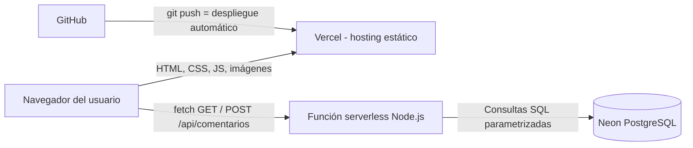
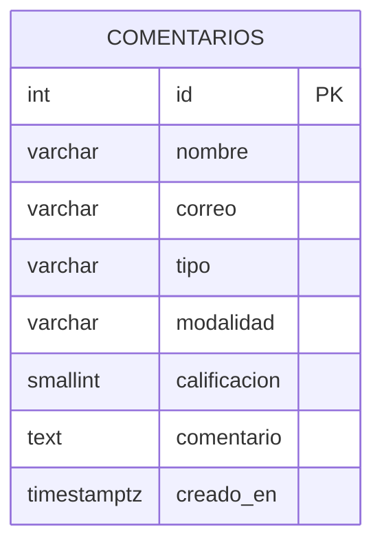

<div align="center">

# Documentación del Proyecto

## Página Web de la Carrera Ingeniería en Computación
### Universidad Nacional Héroes de San José de las Mulas (UNHSJM)

**Examen II Parcial — Programación Web**

<br>

**Giancarlo Javier Montes Arauz**

<br>

Managua, Nicaragua · Noviembre 2026

</div>

---

## Índice

1. [Introducción](#1-introducción)
2. [Objetivos](#2-objetivos)
3. [Tecnologías utilizadas](#3-tecnologías-utilizadas)
4. [Arquitectura](#4-arquitectura)
5. [Estructura del proyecto](#5-estructura-del-proyecto)
6. [Descripción de las secciones](#6-descripción-de-las-secciones)
7. [Hoja de estilo (CSS)](#7-hoja-de-estilo-css)
8. [JavaScript](#8-javascript)
9. [Base de datos](#9-base-de-datos)
10. [API de comentarios](#10-api-de-comentarios)
11. [Seguridad](#11-seguridad)
12. [Publicación en Vercel y GitHub](#12-publicación-en-vercel-y-github)
13. [Ejecución local](#13-ejecución-local)
14. [Pruebas realizadas](#14-pruebas-realizadas)
15. [Fuentes de información](#15-fuentes-de-información)

---

## 1. Introducción

Este proyecto consiste en una página web informativa sobre la carrera de **Ingeniería en Computación** que ofrece la **Universidad Nacional Héroes de San José de las Mulas** (antes Universidad Nacional Politécnica), ubicada en Managua, costado sur de la Colonia Rubén Darío.

El sitio presenta la información de la carrera de forma atractiva y adaptable a cualquier dispositivo, y permite a los visitantes dejar comentarios que se almacenan en una **base de datos en línea** (Neon PostgreSQL).

- **Sitio publicado:** https://examen-ii-parcial-programacion-web.vercel.app
- **Repositorio:** https://github.com/Montes2001/examen-ii-parcial-programacion-web

## 2. Objetivos

**Objetivo general:** desarrollar y publicar una página web sobre la carrera de Ingeniería en Computación de la UNHSJM, con hoja de estilo propia y conexión a una base de datos en línea para almacenar comentarios.

**Objetivos específicos:**

- Presentar la información de la carrera en 10 secciones organizadas y navegables.
- Aplicar una hoja de estilo externa con diseño *responsive* basado en la identidad visual de la universidad.
- Implementar un formulario con validación que guarde los comentarios en una base de datos en línea.
- Publicar el sitio en Vercel con despliegue continuo desde GitHub.

## 3. Tecnologías utilizadas

| Tecnología | Uso |
|---|---|
| **HTML5** | Estructura semántica de la página (`header`, `nav`, `section`, `article`, `footer`) |
| **CSS3** | Hoja de estilo externa: variables, Flexbox, Grid, animaciones y *media queries* |
| **JavaScript (ES6+)** | Carrusel, menú, pestañas, validación y consumo de la API con `fetch` |
| **Node.js** | Función *serverless* que atiende la API |
| **Neon PostgreSQL** | Base de datos relacional en la nube (plan gratuito) |
| **@neondatabase/serverless** | Driver para conectar la función con Neon |
| **Vercel** | Hosting del sitio y de la función serverless |
| **Git / GitHub** | Control de versiones; cada `push` despliega automáticamente en Vercel |
| **Google Fonts (Montserrat)** | Tipografía, la misma del sitio oficial de la UNHSJM |

## 4. Arquitectura



1. El navegador descarga los archivos estáticos desde Vercel.
2. `js/comentarios.js` solicita los comentarios a `/api/comentarios` (GET) y los muestra en *Reseñas*.
3. Al enviar el formulario se hace un POST; la función valida los datos y los inserta en Neon.
4. La cadena de conexión (`DATABASE_URL`) solo existe en el servidor como variable de entorno; nunca llega al navegador.

## 5. Estructura del proyecto

```
Examen ll Parcial - Programacion Web/
├── index.html              Página principal con las 10 secciones
├── css/
│   └── styles.css          Hoja de estilo
├── js/
│   ├── main.js             Menú, carrusel, pestañas, animaciones
│   ├── plan.js             Datos y renderizado del plan de estudio
│   └── comentarios.js      Formulario y reseñas (consume la API)
├── api/
│   └── comentarios.js      Función serverless (GET / POST)
├── db/
│   └── schema.sql          Script de creación de la tabla
├── img/                    Logos oficiales e imágenes del carrusel
├── docs/
│   └── DOCUMENTACION.md    Este documento
├── package.json            Dependencias y scripts
├── vercel.json             Configuración de Vercel (cabeceras de seguridad y caché)
├── .env.example            Plantilla de variables de entorno
├── .gitignore
└── README.md
```

## 6. Descripción de las secciones

| # | Sección | Descripción | Ancla |
|---|---|---|---|
| 1 | **Carrusel informativo** | 4 diapositivas con transición de desvanecimiento, avance automático cada 6 s, flechas, indicadores, teclado (← →) y deslizamiento táctil. Se pausa con el mouse encima. | `#inicio` |
| 2 | **Menú principal** | Barra fija con el logo oficial. Resalta la sección visible y se compacta al bajar. En móviles se convierte en menú hamburguesa lateral. | `header` |
| 3 | **Organigrama** | Árbol jerárquico hecho solo con HTML y CSS: Consejo Universitario → Rectoría → Vicerrectorías / Secretaría General → Direcciones académicas → carreras. Se resalta Ingeniería en Computación. En pantallas pequeñas pasa a formato vertical. | `#organigrama` |
| 4 | **Descripción de la carrera** | Objetivo oficial, descripción, título, dirección académica, duración y turno. | `#carrera` |
| 5 | **Modalidades, duración y horarios** | Tarjetas de las modalidades Regular-Matutina (oficial), Sabatina y Por Encuentro (referenciales), con duración, períodos, días y horario. | `#modalidades` |
| 6 | **Perfiles de salida** | Perfil oficial del egresado y campo laboral. | `#perfiles` |
| 7 | **Áreas de estudio** | Las 5 áreas oficiales más Hardware y Arquitectura, con las asignaturas relacionadas. | `#areas` |
| 8 | **Plan de estudio por modalidad** | Pestañas que generan con JavaScript la malla de cada modalidad: 10 semestres (Matutina), 15 cuatrimestres (Sabatina) y 12 semestres (Por Encuentro). | `#plan` |
| 9 | **Reseñas** | Muestra las reseñas reales guardadas en la base de datos junto con la calificación promedio (permanece vacía hasta que se registre el primer comentario). | `#resenas` |
| 10 | **Formulario de comentarios** | Nombre, correo, tipo de usuario, modalidad, calificación (estrellas) y comentario. Validación en el cliente y en el servidor. | `#comentarios` |

> **Nota sobre el contenido:** el objetivo, la duración (4 ½ años), el turno matutino, el perfil del egresado, las áreas de estudio y el plan de asignaturas son los **publicados oficialmente** en https://unhsjm.edu.ni/ingenieria-en-computacion/. Las modalidades Sabatina y Por Encuentro, los horarios detallados y el organigrama (armado a partir de las direcciones académicas y dependencias que aparecen en el sitio oficial) son **referenciales** y se incluyen con fines académicos. Las modalidades referenciales reparten las mismas 58 asignaturas oficiales, en el mismo orden, en más períodos.

## 7. Hoja de estilo (CSS)

El archivo `css/styles.css` está organizado en bloques numerados y utiliza:

- **Variables CSS** (`:root`) con la paleta del logotipo institucional:

  | Variable | Color | Origen |
  |---|---|---|
  | `--azul` | `#1f3a7a` | Rayos y letras del logo |
  | `--rojo` | `#e0262b` | Línea roja del logotipo |
  | `--magenta` | `#e6197e` | Página izquierda del libro |
  | `--cian` | `#1fb5ea` | Página derecha del libro |
  | `--amarillo` | `#ffcc00` | Sol sobre el libro |

- **Metodología de nombres tipo BEM** (`bloque__elemento--modificador`), por ejemplo `.carrusel__slide`, `.nav__link--cta`.
- **CSS Grid y Flexbox** para todas las distribuciones.
- **Animaciones**: transición del carrusel, aparición de elementos al hacer scroll (`.revelar`) y efectos *hover*.
- **Diseño responsive** con tres puntos de quiebre: 1100 px, 980 px (menú hamburguesa, organigrama vertical) y 640 px (una columna).
- **Accesibilidad**: respeta `prefers-reduced-motion`, foco visible en controles y contraste adecuado.

## 8. JavaScript

| Archivo | Funciones principales |
|---|---|
| `js/main.js` | `iniciarMenu()` – hamburguesa, encabezado compacto, enlace activo con `IntersectionObserver`.<br>`iniciarCarrusel()` – autoplay, flechas, indicadores, teclado y táctil.<br>`iniciarPestanas()` – cambia la modalidad del plan.<br>`iniciarAnimaciones()` – revela elementos al hacer scroll. |
| `js/plan.js` | `PLAN_OFICIAL` – asignaturas oficiales por semestre.<br>`redistribuir()` – reparte las asignaturas en N períodos sin alterar su orden.<br>`renderizarPlan()` – dibuja las tarjetas de la modalidad seleccionada. |
| `js/comentarios.js` | `cargarComentarios()` – GET a la API y muestra las reseñas.<br>`validar()` – reglas del formulario.<br>`iniciarFormulario()` – POST a la API e inserta la nueva reseña sin recargar.<br>`escaparHTML()` – evita XSS al mostrar texto escrito por usuarios. |

## 9. Base de datos

- **Motor:** PostgreSQL 17 en **Neon** (serverless), conectado a Vercel mediante su integración oficial.
- **Variable de entorno:** `DATABASE_URL` (la crea automáticamente la integración).

### Tabla `comentarios`

| Campo | Tipo | Restricción | Descripción |
|---|---|---|---|
| `id` | `SERIAL` | PK | Identificador |
| `nombre` | `VARCHAR(100)` | NOT NULL | Nombre del visitante |
| `correo` | `VARCHAR(150)` | NOT NULL | Correo (no se muestra públicamente) |
| `tipo` | `VARCHAR(30)` | NOT NULL | Estudiante, Egresado, Docente, Aspirante, Visitante |
| `modalidad` | `VARCHAR(30)` | NOT NULL | Matutina, Sabatina, Por Encuentro |
| `calificacion` | `SMALLINT` | 1 a 5 | Calificación en estrellas |
| `comentario` | `TEXT` | NOT NULL | Texto del comentario |
| `creado_en` | `TIMESTAMPTZ` | DEFAULT NOW() | Fecha y hora de registro |



El script está en `db/schema.sql`. Además, la API crea la tabla automáticamente si no existe.

## 10. API de comentarios

**Ruta:** `/api/comentarios` — archivo `api/comentarios.js`

### `GET /api/comentarios`
Devuelve los últimos 30 comentarios (sin correos), el promedio y el total.

```json
{
  "comentarios": [
    { "id": 1, "nombre": "Juan Pérez", "tipo": "Estudiante", "modalidad": "Matutina",
      "calificacion": 5, "comentario": "Excelente carrera...", "creado_en": "2026-11-21T04:50:00.000Z" }
  ],
  "promedio": 5,
  "total": 1
}
```

### `POST /api/comentarios`
Cuerpo JSON:

```json
{ "nombre": "Juan Pérez", "correo": "juan@correo.com", "tipo": "Estudiante",
  "modalidad": "Matutina", "calificacion": 5, "comentario": "Excelente carrera..." }
```

| Código | Significado |
|---|---|
| `201` | Comentario guardado (devuelve el registro creado, el promedio y el total) |
| `422` | Datos inválidos (devuelve los errores por campo) |
| `405` | Método no permitido |
| `500` | Error del servidor o de la base de datos |

## 11. Seguridad

- **Inyección SQL:** todas las consultas usan *tagged templates* del driver de Neon, que envían los valores como parámetros.
- **XSS:** el texto de los usuarios se escapa antes de insertarse en el DOM (`escaparHTML`).
- **Doble validación:** en el navegador (experiencia de usuario) y en el servidor (seguridad).
- **Privacidad:** el correo se guarda pero nunca se devuelve en la API pública.
- **Credenciales:** `DATABASE_URL` vive solo en las variables de entorno de Vercel; `.env*` está excluido en `.gitignore`.
- **Anti-spam:** campo trampa (*honeypot*) oculto que los bots suelen rellenar.
- **Cabeceras HTTP** (`vercel.json`): `X-Content-Type-Options`, `X-Frame-Options`, `Referrer-Policy`.

## 12. Publicación en Vercel y GitHub

1. Se creó el repositorio en GitHub y se subió el código:
   ```bash
   git init -b main
   git add .
   git commit -m "Página web Ingeniería en Computación UNHSJM"
   gh repo create examen-ii-parcial-programacion-web --public --source . --push
   ```
2. Se vinculó el proyecto con Vercel y se conectó el repositorio de GitHub:
   ```bash
   vercel login
   vercel link
   vercel git connect
   ```
3. Se agregó la base de datos **Neon** desde la integración de Vercel (*Storage → Neon*), que crea la variable `DATABASE_URL` en el proyecto.
4. Se publicó en producción:
   ```bash
   vercel --prod
   ```
5. A partir de ahí, **cada `git push` a la rama `main` despliega automáticamente** una nueva versión.

## 13. Ejecución local

Requisitos: Node.js 18 o superior y Vercel CLI (`npm i -g vercel`).

```bash
npm install
vercel link                  # vincular la carpeta con el proyecto de Vercel
vercel env pull .env.local   # descargar DATABASE_URL
vercel dev                   # abrir http://localhost:3000
```

## 14. Pruebas realizadas

| Prueba | Resultado esperado |
|---|---|
| Navegación desde el menú a las 10 secciones | Desplazamiento suave y enlace activo resaltado |
| Carrusel: autoplay, flechas, puntos, teclado, táctil | Cambia de diapositiva correctamente |
| Pestañas del plan de estudio | Muestra 10, 15 y 12 períodos según la modalidad |
| Formulario vacío o con correo inválido | Muestra mensajes de error por campo |
| Formulario válido | Se guarda en Neon y aparece en Reseñas sin recargar |
| `GET /api/comentarios` | Devuelve JSON sin el campo correo |
| Vista en móvil, tableta y escritorio | El diseño se adapta (menú hamburguesa, organigrama vertical) |

## 15. Fuentes de información

- Universidad Nacional Héroes de San José de las Mulas — *Ingeniería en Computación*: https://unhsjm.edu.ni/ingenieria-en-computacion/
- UNHSJM — *Oferta de grado*: https://unhsjm.edu.ni/oferta-de-grado/
- Documentación de Vercel Functions: https://vercel.com/docs/functions
- Documentación de Neon: https://neon.com/docs
- Logotipos oficiales de la UNHSJM proporcionados por el autor.
- Imágenes del carrusel generadas con inteligencia artificial para este proyecto.
